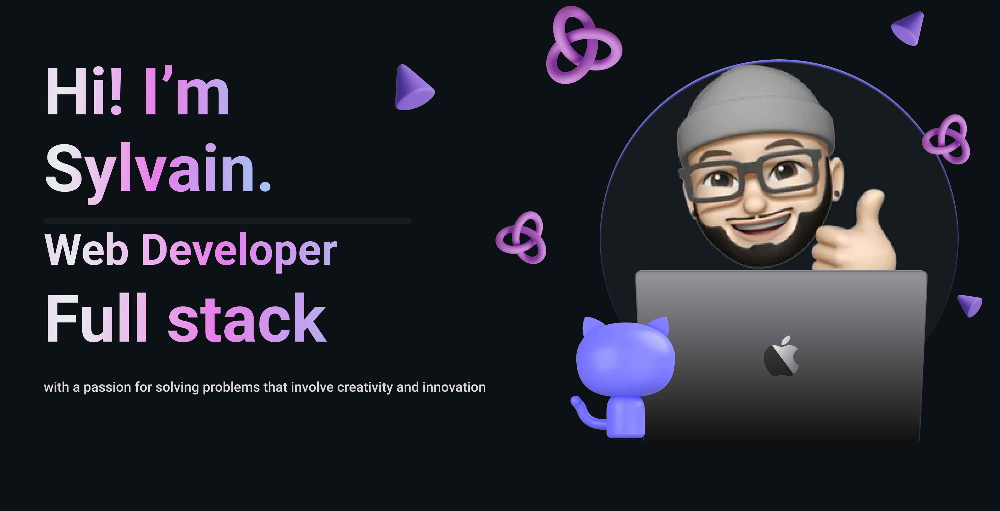

  

<h1 align="center">Sylvain Boudacher</h1>

  <strong>Full-Stack Engineer · TypeScript end to end</strong> 
  React · Next.js · Node.js · NestJS · Hono · Prisma

  
  
  

---

## About

I'm a full-stack engineer based in Paris who builds products from the database schema to the last pixel.
I care about **type-safe architectures**, **clean domain logic** and **interfaces that feel effortless**, and I like owning a feature end to end: data model, API, UI, tests and delivery.

- **Full-stack TypeScript**: React / Next.js on the front, Node.js / NestJS / Hono on the back, with shared types and validation across the stack
- **Product mindset**: I turn complex problems into simple, intuitive tools and work closely with design (Figma)
- **Quality first**: test-driven development, strict typing, monorepos and reproducible environments with Docker
- **AI-native workflow**: I build with Claude Code and the Model Context Protocol (MCP) to connect apps to AI assistants
- **Background**: Web Engineering graduate from **ESGI Paris**

---

## Tech Stack

**Languages**

  

**Front-end**

  

shadcn/ui · TanStack Query · Motion · Zod

**Back-end & Data**

  

Hono · REST · type-safe RPC · Model Context Protocol (MCP)

**Tooling & DevOps**

  

---

## Featured Project

### Ascent Planner

A local-first personal planning app: projects broken into ordered objectives, a daily planner, a timeline and an MCP server so an AI assistant can read and plan tasks.

| Layer | Stack |
| --- | --- |
| Monorepo | Bun workspaces · shared `core` package (Zod schemas + pure business rules) |
| API | Hono · Prisma 7 · SQLite (libSQL) · end-to-end types with the Hono RPC client |
| Front-end | React 19 · Vite · Tailwind 4 · shadcn/ui · TanStack Query · Motion |
| AI | MCP server exposing the same services as the REST API |
| Quality | TDD on every layer · strict TypeScript · oxlint |

---

## GitHub Stats

  
  

---

  Let's build something great together. Reach out on <a href="https://www.linkedin.com/in/sylvain-boudacher/">LinkedIn</a>.

